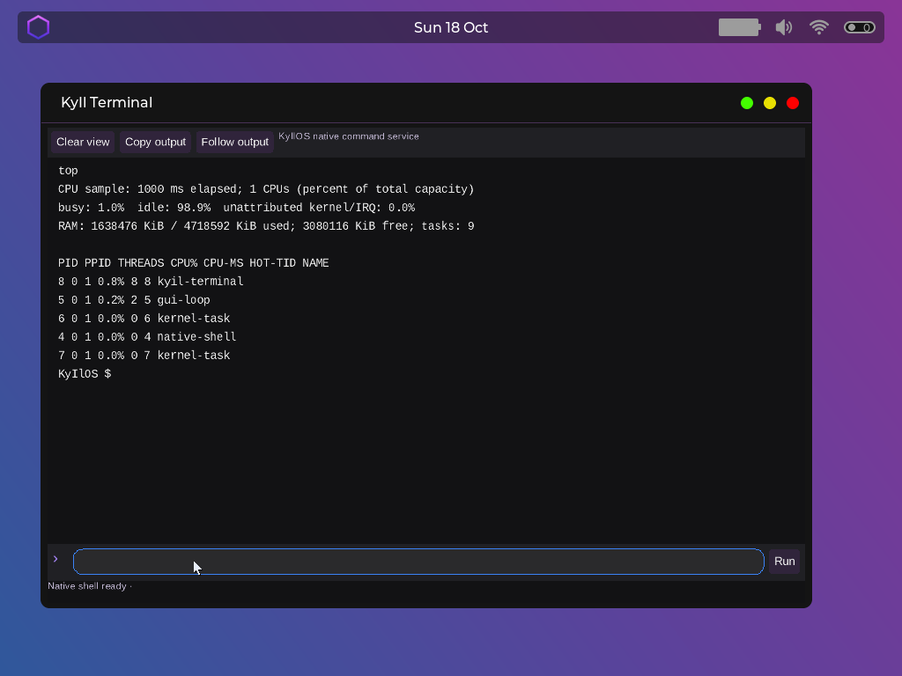

# KyIlOS

**Un système d’exploitation x86-64 expérimental, du noyau au bureau.**

KyIlOS développe ses propres modèles de mémoire, d’ordonnancement, de ressources
et d’interface graphique. Le bureau accueille des applications natives en Suchu,
un navigateur WebKit et des couches de compatibilité ELF/Linux et Windows/PE.

Ce dépôt présente le **snapshot du 18 octobre 2026**. Il contient les sources utiles,
les outils et la documentation ; l’image prête à démarrer est distribuée séparément
dans les [Releases](https://github.com/Printemilio/KyIl-OS/releases).



> Projet en développement actif : les fonctionnalités ci-dessous ont des niveaux
> de couverture différents. Chrome pour Windows ne dispose pas encore d’une
> fenêtre fonctionnelle sous KyIlOS. Vulkan n’est pas une implémentation certifiée.

## Essayer KyIlOS en quelques minutes

Sous Windows, installer **Git**, **PowerShell 7** et **VirtualBox**. Une machine hôte
avec virtualisation matérielle activée et suffisamment de mémoire libre est nécessaire.
Le profil fourni réserve **4 Gio de RAM et 4 vCPU** ; il peut être ajusté.

```powershell
git clone https://github.com/Printemilio/KyIl-OS.git
cd KyIl-OS
.\scripts\download-vm.ps1
.\scripts\start-vm.ps1
```

Le téléchargement utilise la release correspondant exactement à ce dépôt, puis
vérifie le **SHA-256 de l’archive et de l’ISO extraite**. Aucun compilateur, SDK
Windows, outil Suchu ou build WebKit n’est nécessaire pour essayer l’image.

Un autre profil est possible :

```powershell
.\scripts\start-vm.ps1 -CpuCount 1 -MemoryMB 4096 -VmName KyIlOS-Test
```

Le lanceur crée sa propre VM en **BIOS Legacy / PIIX3**, avec une carte **Intel
82540EM en NAT**. Il refuse de réutiliser une VM étrangère, de couper une VM en
cours d’exécution ou de supprimer son état sauvegardé. Il ne formate et n’attache
aucun disque de l’hôte. `-Firmware efi` est disponible, mais le profil de référence
de cette publication est BIOS.

Sans Git, télécharger `KyIlOS-2026.10.18-vm.zip` depuis la
[release du snapshot](https://github.com/Printemilio/KyIl-OS/releases/tag/v2026.10.18),
l’extraire dans un dossier, puis lancer `scripts/start-vm.ps1` depuis ce dossier.
L’archive contient l’image, ce lanceur et sa fiche d’intégrité.

### Une fois sur le bureau

- Le menu contextuel du bureau permet d’ouvrir les applications.
- Terminal, Files, Editor, Paint, Browser et le lanceur d’applications utilisent
  leurs intégrations natives Suchu/Raylib.
- Le Terminal conserve le shell natif et ses commandes, notamment `top`,
  `shutdown` et `reboot`.
- Browser utilise WebKit pour le **contenu Web** ; son interface et ses onglets
  appartiennent à l’application native.
- Pour arrêter la VM, utiliser le menu du bureau ou `shutdown` dans le Terminal.

**Persistance :** ce lancement minimal n’ajoute aucun disque de données. Les
fichiers créés pendant la session sont donc volatils. Une partition VexFS dédiée
est nécessaire pour la persistance ; les scripts de démarrage ne préparent jamais
automatiquement un disque physique. Les disques de développement et données
personnelles de la machine de l’auteur ne sont pas publiés.

Les journaux série sont écrits dans `build/kyilos-serial-*.log`. Si PowerShell
bloque l’exécution des scripts téléchargés, les débloquer après inspection avec
`Unblock-File .\scripts\*.ps1` ; aucune modification globale de politique n’est requise.

## Ce qui existe aujourd’hui

| Domaine | État et limites |
|---|---|
| **Noyau et démarrage** | Noyau x86-64 natif, Limine, BIOS/UEFI, PMM/VMM, exceptions, syscalls et protections user/kernel. Les correctifs de calibration PIT/RTC/TSC/LAPIC pour les anciens CPU sont conservés. |
| **SMP / FlowSched** | État par CPU, placement et migration des tâches, groupes de ressources, IPI et TLB shootdowns. Le dernier runner Windows a été exécuté en 1 et 4 vCPU. |
| **Mémoire / ORA** | Stockage et références explicites, contenu immutable canonicalisable, backings mutables distincts, mappings sparse/lazy et ownership process-wide. |
| **Sécurité / IPC** | Capabilities avec droits, objets partagés refcountés, IPC orienté messages et transfert d’objets. Ultra-Space héberge des services utilisateurs confinés et éphémères. |
| **Bureau / Suchu** | Bureau natif et compositor ; applications Suchu/Raylib intégrées, événements, focus et surfaces natives. Les anciennes applications C/LVGL restent disponibles dans l’arbre de développement. |
| **Graphique** | Renderer logiciel programmable en userspace, Surface et backings partageables, EGL/GLES pour les workloads portés. Vulkan comprend de vraies queues asynchrones et un WSI multi-image, avec une couverture encore partielle. |
| **Web / réseau** | Browser Suchu + WPE/WebKit, rendu réel, navigation Internet HTTP/HTTPS via les primitives réseau système. Les performances et la couverture ne sont pas celles d’un navigateur de production. |
| **ELF / Linux** | ABI native et couche de compatibilité Linux pour des workloads ELF/glibc, dont le runtime WebKit porté. Il ne s’agit pas d’une compatibilité Linux universelle. |
| **Windows / PE** | Chargement PE direct, TEB/PEB/TLS et contrats Win32/NT en userspace. Chrome 155.0.8059.84 atteint son point d’entrée et lance son enfant Crashpad. **USER32/GDI et de nombreux contrats restent à développer.** |
| **Pilotes `.driver`** | Archives externes interprétées par un moteur générique ; ressources contrôlées et DMA médié par ORA. La disponibilité d’un backend dépend du périphérique et du chemin réellement validé. |

La compatibilité avec le Dell Latitude D630 a fait l’objet d’un portage réel.
Cette release est cependant validée ici en VM : elle ne promet pas que le Wi-Fi,
le GPU, l’USB et chaque contrôleur de tous les PC soient pris en charge.

## Architecture en bref

```text
Applications natives Suchu / C        Applications ELF        Applications PE
              │                             │                       │
       Suchu / Raylib                 ABI native / VSL       runtime Win32 / NT
              │                             │                  en userspace
              └─────────────────────────────┴───────────────────────┘
                              ABI native KyIlOS
                                     │
       FlowSched · ORA / VMM · capabilities · IPC · VexFS · pilotes
                                     │
                       CPU / mémoire / périphériques

Graphique : renderer userspace → backing / Surface → compositor → écran
Web       : chrome natif Suchu → viewport WebKit → chemin graphique commun
```

Ultra-Space réutilise les processus, la mémoire, les capacités et l’IPC existants.
Il ne convertit pas les applications Windows en ELF et ne remplace pas les API
Windows encore absentes. W^X reste strict ; la compatibilité n’accorde pas de RWX
générique pour faire avancer un programme.

## Sources et développement

| Dossier | Contenu |
|---|---|
| `kernel/` | Noyau, architecture x86-64, mémoire, scheduler, VSL, FS, sécurité, compositor et interfaces matérielles. |
| `userspace/` | `libvex`, libc, runtime Windows, renderer, intégrations Raylib/OCaml et copie intégrée de Suchu. |
| `boot/`, `drivers/`, `etc/` | Configuration de boot, descriptions de pilotes et configurations runtime. |
| `scripts/`, `tests/` | Builds, packaging, lancements et validations ciblées. |
| `toolchain/`, `third_party/` | Wrappers de cross-compilation, versions amont et patches ; pas les caches de dépendances. |
| `docs/` | Architecture, portage matériel, contrats et comptes rendus de validation. |
| `release/` | Métadonnées de l’image publiée et checksums. |

Les ISO, disques VM, objets compilés, arbres de staging, caches, journaux volumineux
et SDK locaux ne sont pas versionnés. `source-manifest.json` inventorie les fichiers
de développement repris du checkpoint, avec leurs SHA-256.

### Reconstruire

Pour le noyau : Git, Clang/LLVM et `ld.lld` ; les dépendances noyau épinglées sont
récupérées par le script de build.

```powershell
.\scripts\build.ps1 -NoIso
```

Cela reconstruit **le noyau**, pas tout le runtime présent dans l’ISO publiée.
Reconstituer intégralement le desktop nécessite aussi les toolchains Suchu/OCaml,
Raylib, WPE/WebKit, glibc, les ressources et le staging. Les scripts correspondants
sont conservés, mais un clone des seules sources n’est pas présenté comme un build
complet du système en une commande. Pour essayer le système, utiliser la release.

Points d’entrée : [Suchu](docs/suchu-on-vex.md),
[applications desktop](docs/suchu-desktop-apps.md),
[toolchain native](docs/native-toolchain.md),
[Ultra-Space](docs/ultra-space.md), [ORA](docs/ora-migration.md),
[FlowSched](docs/flowsched.md) et [format `.driver`](docs/driver-format.md).

## Validation du snapshot

L’image publiée est **l’image déjà testée**, sans nouveau rebuild du noyau pour
cette mise en ligne. Les runners Windows complets et le census des exports passent
en VM **1 et 4 vCPU**, ainsi que les smokes inclus de TLS/FPU Linux, W^X, fautes,
ownership mémoire, IPC et isolation Ultra-Space. Les tests de référence hôte et
les six tests de graphe PE sont également documentés.

Le lancement Chrome reste une **trace de progression**, pas un test réussi de son
interface : `USER32.dll!FindWindowExW` est absent, et Crashpad rencontre un parent
de répertoire manquant. Le package plus large comporte encore de nombreux contrats
manquants. Aucun support complet Windows ou Vulkan n’est annoncé.

[État précis Windows/Chrome](docs/windows-startup-progress-2026-10-18.md) ·
[frontière structurée](docs/windows-chrome-main-frontier.json) ·
[état SMP](docs/smp-progress.md) · [portage D630](docs/d630-port.md)

L’ISO contient les composants de test et runtime du checkpoint, notamment le package
Chrome de validation ; elle ne contient pas les disques de données de développement.
Le support matériel et les performances restent à vérifier sur chaque machine.

## Licence et composants tiers

Le code propre au projet est distribué selon [LICENSE](LICENSE), sous réserve des
mentions présentes dans les fichiers. Suchu et les autres composants tiers gardent
leurs licences respectives ; la licence du dépôt ne relicencie pas WebKit, glibc,
les polices, les dépendances ou les exécutables Chrome inclus dans le payload.

Le nom **Vex / VexOS** subsiste dans certains identifiants, chemins et ABI internes
pour préserver les contrats existants. Le nom affiché du système est **KyIlOS**.
